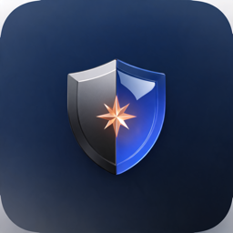
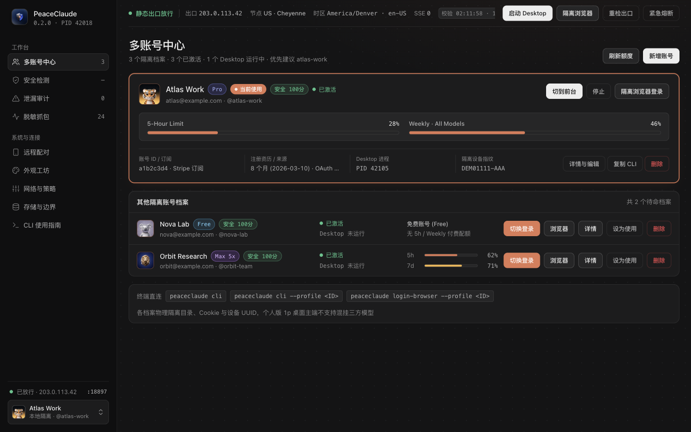
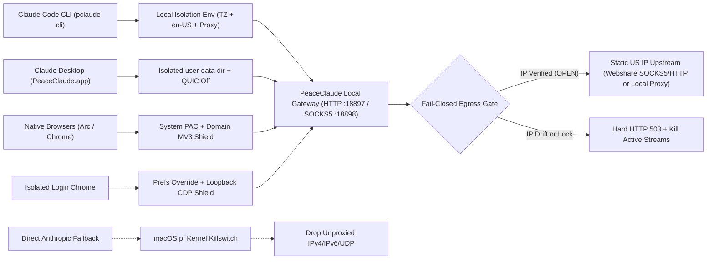
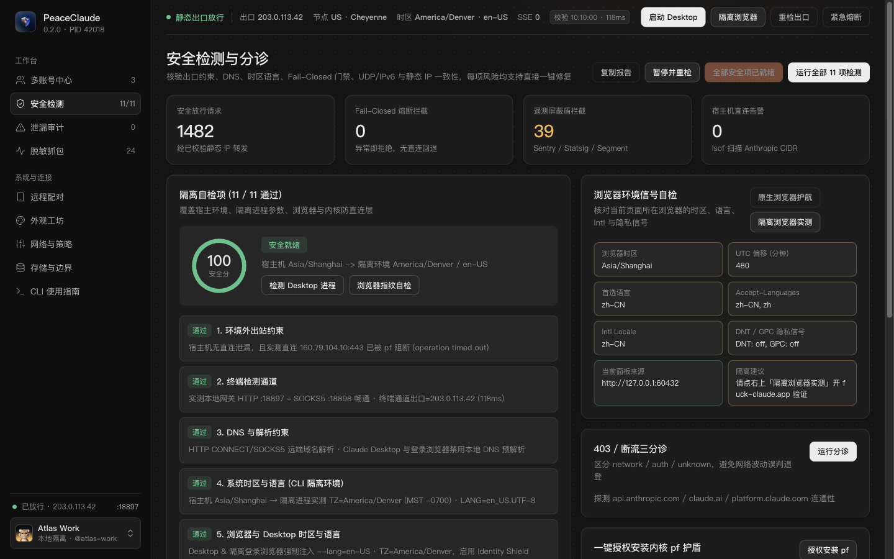
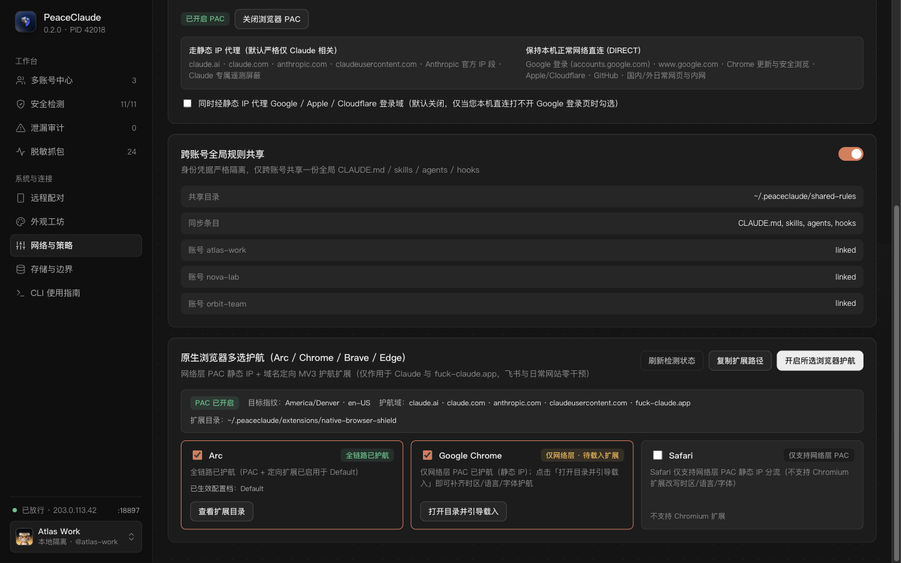
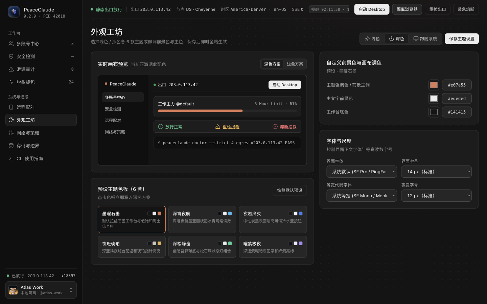
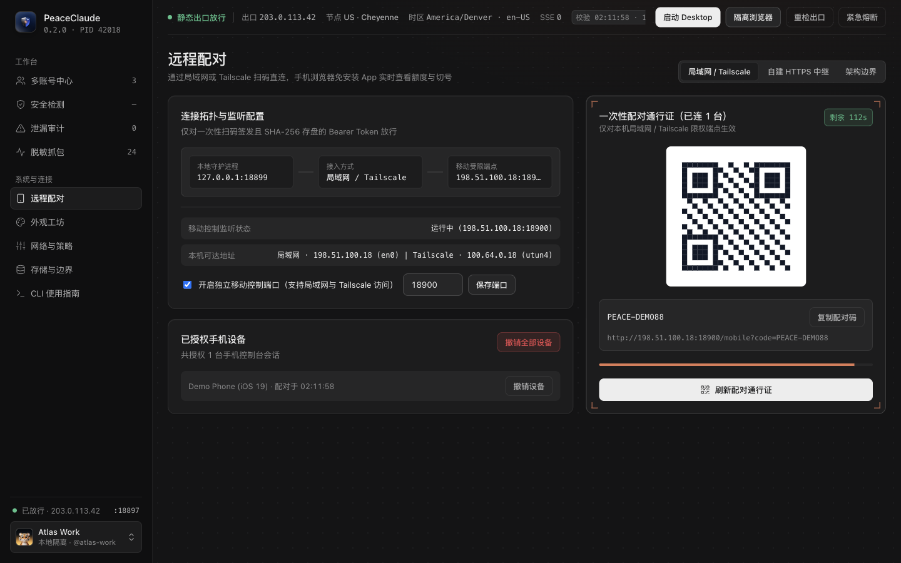
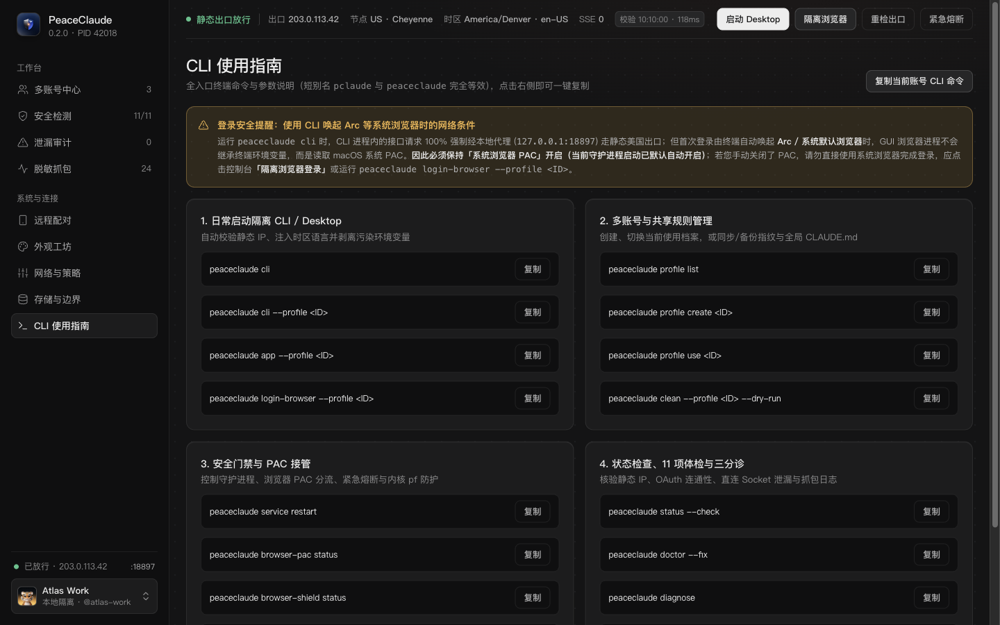

<p align="center">
  
</p>

<h1 align="center">PeaceClaude</h1>

<p align="center">
  <strong>Zero-VM, Fail-Closed Static-IP Cockpit for Claude on macOS.</strong><br/>
  Run Claude Desktop, Claude Code CLI, and your everyday Arc / Chrome / Brave browsers at native speed — locked to your static US egress IP, synced timezone/locale, and verified <code>2 / 100 LOW RISK</code> anti-fingerprint posture.
</p>

<p align="center">
  <strong>English</strong> · <a href="README.zh-CN.md">简体中文</a> · <a href="docs/CLI_GUIDE.md">CLI Guide</a> · <a href="website/index.html">Official Landing Page</a>
</p>

<p align="center">
  
  
  
  
  
</p>

---

<p align="center">
  
</p>

## Why PeaceClaude?

Developers on macOS using a static US IP face an ugly trade-off: bare proxy setups leak real local sockets, host `Asia/Shanghai` timezones, and Chinese browser fingerprints — while running an 8 GB Linux desktop VM destroys battery life, breaks native macOS workflows, and adds display lag.

**PeaceClaude takes a third path:** a single zero-dependency Go binary (`~18 MB` RAM, `<0.2s` startup) paired with a native Swift/WKWebView app, kernel `pf` fail-safe anchors, and a surgical domain-scoped Chromium MV3 shield.

| Dimension | Naked System Proxy / TUN | Heavy Linux VM | **PeaceClaude (Zero-VM)** |
|---|---|---|---|
| **Memory & Disk Overhead** | `~50–200 MB`, easy to break | `4–8 GB RAM`, `15–30 GB` disk | **`~18 MB RAM`, `16 MB` bundle** |
| **Cold Start Time** | `< 1s` | `25–45s` VM boot | **`< 0.2s` instant launch** |
| **Native App Experience** | Native (but frequently leaks) | Remote framebuffer lag | **100% Native Claude Desktop, CLI & Arc/Chrome** |
| **Egress Fail-Closed** | Drops back to direct on proxy blip | Depends on guest firewall | **Instant `503` + active socket kill + `pfctl` anchor** |
| **Timezone / Locale / Font Alignment** | Exposes `Asia/Shanghai` & `zh-CN` | Requires full guest OS config | **Auto-synced to egress city (`TZ`, `LANG`, `Intl`, Canvas)** |
| **Native Browsers (Arc / Chrome)** | All sites or Split-IP leakage | Separate VM browser only | **PAC + Domain-Scoped MV3 Shield (`2/100 LOW RISK`)** |
| **Multi-Account Switching** | Manual token juggling | Multiple VMs or manual cleanup | **Physical profile isolation + Single-Active `claude://` routing** |
| **Enterprise VPN Coexistence** | TUN often breaks corporate VPN | Bridge conflicts | **Zero TUN · Coexists cleanly with corporate VPNs** |

---

## Architecture Overview

Every Anthropic/Claude surface routes through PeaceClaude's local Fail-Closed Egress Gate, while everyday work, Slack/Lark, and domestic traffic stay completely untouched.



---

## Key Capabilities & Workbench Tour

### 1. 11-Point Security Doctor & Zero-Redundancy Triage
Verifies IPv4/IPv6 kernel `pf` blocks, remote DNS resolution (`SOCKS5 ATYP=DOMAIN`), CLI/Desktop timezone & language injection, physical profile isolation, Fail-Closed policy enforcement, QUIC/WebRTC UDP suppression, and static IP consistency in real time — with one-click remediation and instant score recalculation (`0–100`).

<p align="center">
  
</p>

### 2. Multi-Select Native Browser Shield (Arc / Chrome / Brave / Edge)
Enabling PAC alone routes IP traffic — but native browsers still broadcast `Asia/Shanghai`, `zh-CN`, and Chinese font lists. PeaceClaude combines **strict Claude-only PAC routing** with a **Domain-Scoped MV3 Shield Extension** (`~/.peaceclaude/extensions/native-browser-shield/`):
- Only injects US timezone (`Date` prototype + `Intl` 8 constructors), `en-US` headers (`declarativeNetRequest`), GPC/DNT, Canvas CJK font scrubbing, and WebRTC UDP policy on `claude.ai`, `claude.com`, `anthropic.com`, `claudeusercontent.com`, and `fuck-claude.app`.
- **Zero interference** on everyday work tabs, corporate intranets, or other sites (native timezone/language preserved 100%).
- Tested on native `Asia/Shanghai` + `zh_CN` Chrome process with PAC + Shield Extension: achieves **`2 / 100 (LOW RISK)`** on `fuck-claude.app`.

<p align="center">
  
</p>

### 3. Original Workbench, Themes & LAN/Tailscale Remote Control
Built as a pure-Go embedded console (`http://127.0.0.1:18899`) and native Swift/WKWebView app (`/Applications/PeaceClaude.app`):
- **Appearance Studio**: 6 light + 6 dark curated palettes, custom primary accent / foreground / surface overrides, font scaling, and `⌘L` instant privacy lock.
- **Mobile Pairing Pass**: Generates ephemeral 120s ISO-18004 SVG QR tickets (`SHA-256` hashed Bearer tokens, strict zero-cloud-relay) for switching profiles or locking egress from your phone over LAN or Tailscale.
- **Built-in CLI Guide**: Categorized command launcher with one-click copy inside the app.

| Appearance Studio | Mobile Pairing Pass | Built-in CLI Guide |
|---|---|---|
|  |  |  |

---

## 30-Second Quick Start

### Option A: Universal macOS Release Package (No Go Required · Apple Silicon & Intel)

Download from **GitHub Releases**:

- **DMG Installer (`PeaceClaude-v0.2.0-macos-universal.dmg`)**:
  1. Drag **`PeaceClaude.app`** into **`Applications`** (self-contained: embeds universal CLI inside `Contents/Resources/bin/peaceclaude`).
  2. Double-click **`Install-PeaceClaude-CLI.command`** in the DMG to install `peaceclaude` / `pclaude` CLI and start the LaunchAgent gateway.
- **Offline Archive (`peaceclaude-v0.2.0-macos-universal.tar.gz`)**:
  ```bash
  tar -xzf peaceclaude-v0.2.0-macos-universal.tar.gz
  cd peaceclaude-v0.2.0-macos-universal
  ./install.sh
  ```

> If macOS displays an unverified developer prompt on first launch (ad-hoc signed open-source build), run once:
> `xattr -dr com.apple.quarantine /Applications/PeaceClaude.app ~/.local/bin/peaceclaude`

### Option B: Build from Source (Requires Go 1.24+)

```bash
chmod +x ./install.sh
./install.sh
```

Installed layout (all existing user accounts & `~/.claude` remain strictly untouched):
- **CLI**: `~/.local/bin/peaceclaude` & short alias `pclaude`
- **Desktop App**: `/Applications/PeaceClaude.app` (native Swift/WKWebView + bundled CLI)
- **LaunchAgent**: `com.peaceclaude.daemon` (`127.0.0.1` loopback only)
- **State Directory**: `~/.peaceclaude/` (`0700`/`0600` strict permissions, 30-day rolling log/capture retention with automatic secret redaction)

---

## Essential Commands

```bash
# Daily isolated launchers
peaceclaude cli                           # Launch isolated Claude Code CLI (pclaude cli)
peaceclaude cli --profile atlas-work      # Launch a specific isolated profile
peaceclaude app                           # Launch isolated Claude Desktop
peaceclaude login-browser                 # Open isolated Chrome with 2/100 LOW RISK shield

# Native browser & network defense
peaceclaude browser-pac on                # Route Claude traffic from Arc/Chrome/Safari via static IP
peaceclaude browser-shield status         # Inspect MV3 shield loading across Arc/Chrome/Brave/Edge
peaceclaude browser-shield open --browser arc  # Reveal extension folder & open guide for Arc

# Upstream & diagnostics
peaceclaude config set-upstream --mode direct-socks5 --addr <IP>:<PORT> --user <U> --pass <P> --expected-ip <IP>
peaceclaude status                        # Live egress gate, IP, city/timezone, and defense overview
peaceclaude doctor --fix                  # Run 11-point security audit & auto-remediate issues
peaceclaude diagnose                      # Triage 403/drops cleanly (network vs auth vs unknown)
peaceclaude lock "maintenance"            # Emergency Fail-Closed cut-off
```

Full command reference & safety walkthrough: [docs/CLI_GUIDE.md](docs/CLI_GUIDE.md).

---

## Honest Security Boundaries (Zero-VM Design)

PeaceClaude optimizes for **zero-friction native speed and deterministic network/fingerprint isolation**, without claiming VM kernel virtualization:
1. **What it guarantees**: Fail-Closed static-IP gating (`no direct fallback`), active socket severance on IP drift/lock, kernel `pf` IPv4/IPv6/UDP anchor blocking, physical `~/.peaceclaude/profiles/<id>/` config/Desktop/browser separation, host env stripping (`ANTHROPIC_BASE_URL`), telemetry blocking, and aligned timezone/locale/CJK font surfaces.
2. **Where a VM still differs**: All processes run under the same macOS UID — malicious code executed inside a Claude Code session still has access to normal user-space files unless further constrained by directory permissions or a separate macOS user/VM.
3. **Host browser extension safety**: Chromium browsers on macOS block silent force-installation of unsigned extensions; PeaceClaude generates the domain-scoped MV3 bundle locally, guides a 10-second developer-mode load per chosen browser, and verifies active status directly from browser `Preferences`.
