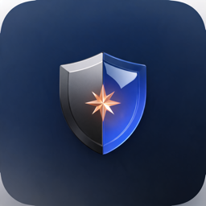
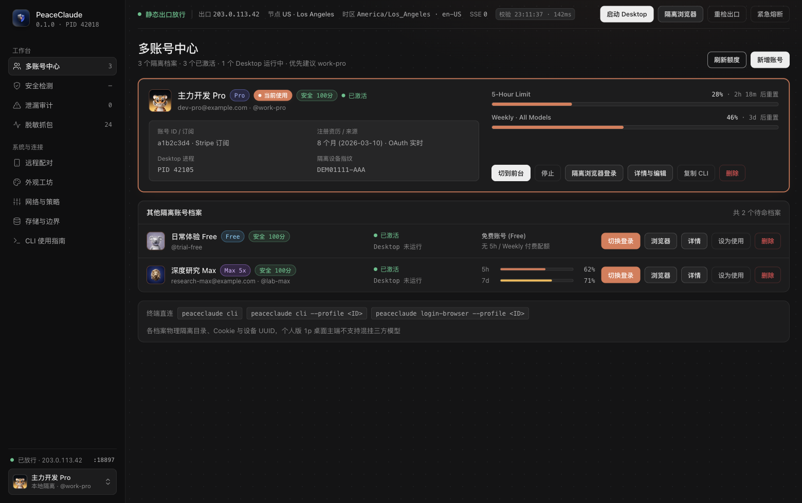
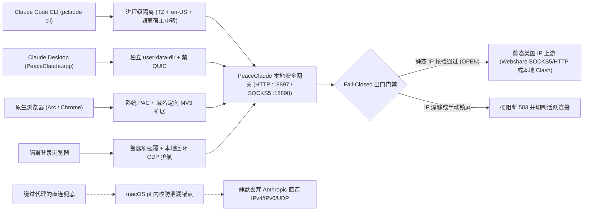
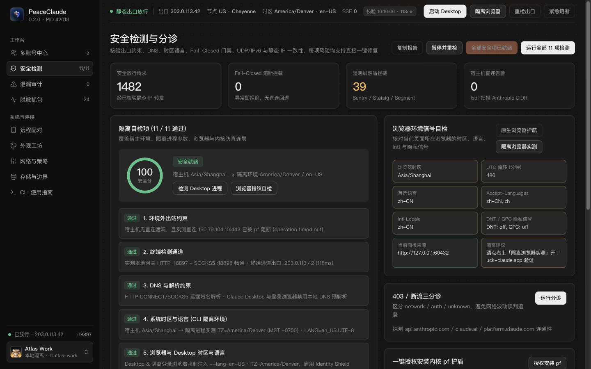
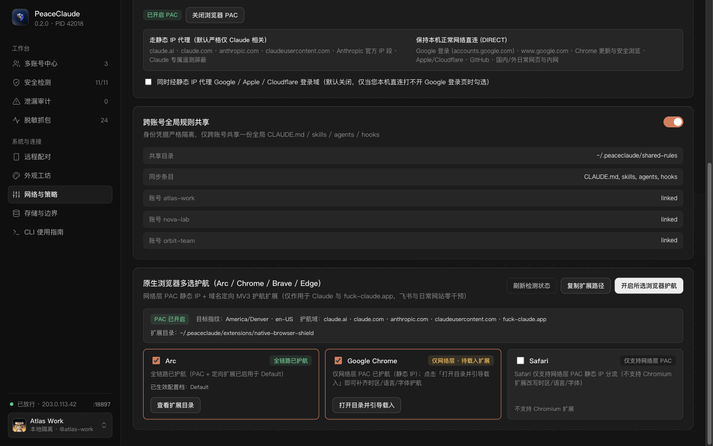
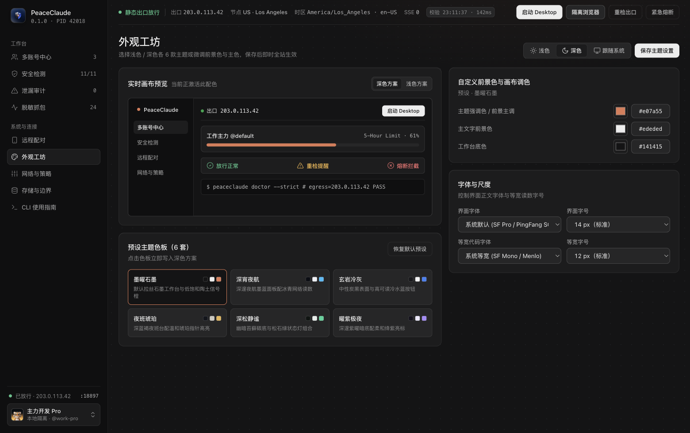
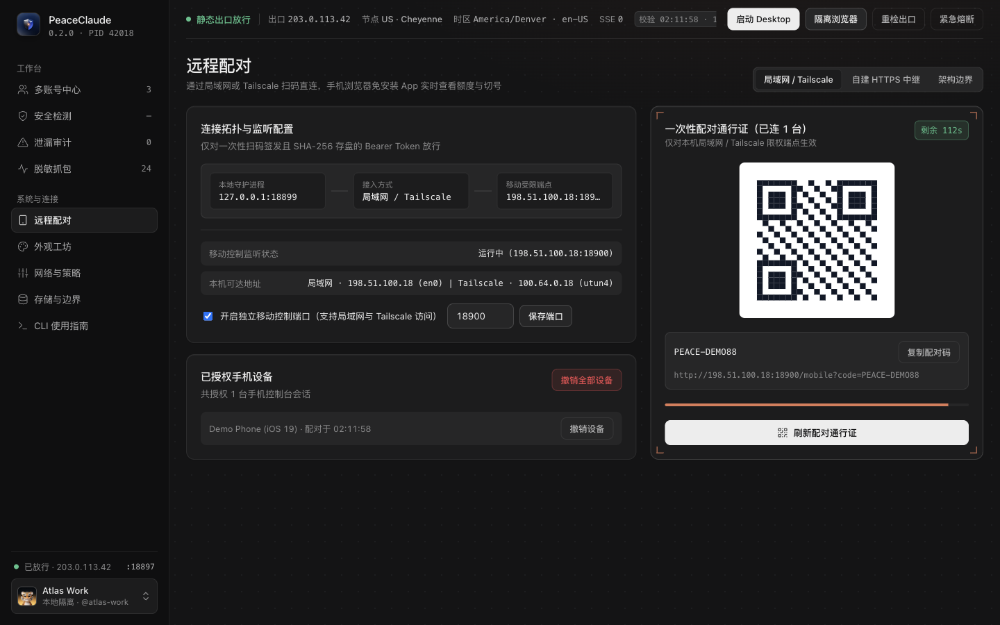
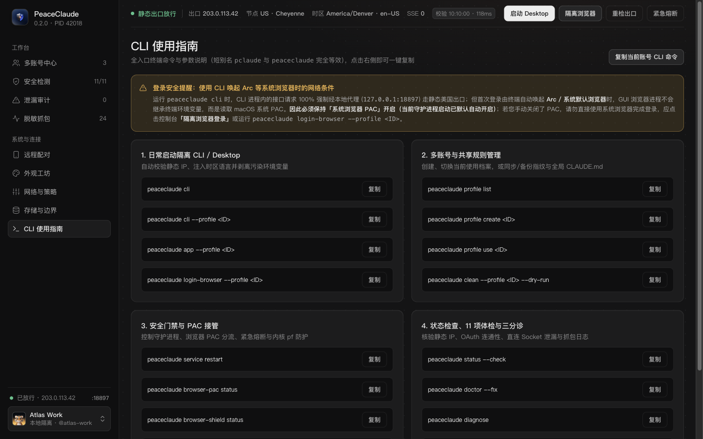

<p align="center">
  
</p>

<h1 align="center">PeaceClaude</h1>

<p align="center">
  <strong>覆盖 macOS · Windows · Ubuntu · Web · iOS 的零虚拟机静态 IP Claude 全入口安全工作台</strong><br/>
  零虚拟机开销，同时纳管 Claude Desktop、Claude Code CLI 与原生 Arc / Chrome / Brave 浏览器：<br/>
  严格锁定静态美区 IP、实时同步城域时区语言、实测防风控检测稳居 <code>2 / 100 LOW RISK</code>，并配备纯原生 SwiftUI 伴侣应用 <strong>PeaceSwitch</strong>。
</p>

<p align="center">
  <a href="README.md">English</a> · <strong>简体中文</strong> · <a href="docs/CLI_GUIDE.md">CLI 完整指南</a> · <a href="website/index.html">独立介绍官网</a> · <a href="ios/APP_STORE_GUIDE.md">iOS 上架指南</a> · <a href="docs/DEPLOYMENT_GUIDE.md">官网托管指南</a>
</p>

<p align="center">
  
  
  
  
  
</p>

---

<p align="center">
  
</p>

## 为什么选择 PeaceClaude？

在 macOS 上用静态 IP 使用官方 Claude 长期面临两难：直接开系统代理极易因链路抖动、Split-IP、`Asia/Shanghai` 时区或中文浏览器字体暴露环境特征；而在本地跑一个完整的 Linux 桌面虚拟机，每次吃掉 4–8 GB 内存和几十 GB 磁盘，画面拖拽卡顿，还割裂了原本丝滑的 macOS 开发流。

**PeaceClaude 给出第三条路**：以纯 Go 零外部依赖的单二进制安全网关为核心（内存仅 `~18 MB`、启动 `<0.2s`），配合原生 Swift/WKWebView 桌面控制台、内核级 `pf` 防直连锚点与域名定向 MV3 护航扩展，让官方全入口在宿主机原生运行态下同时拥有确定性的安全门禁。

| 对比维度 | 裸系统代理 / TUN 接管 | 重量级 Linux 桌面虚拟机 | **PeaceClaude（零虚拟机架构）** |
|---|---|---|---|
| **内存与磁盘开销** | `50–200 MB`，规则易漂移 | `4–8 GB` 内存 + `15–30 GB` 磁盘 | **`~18 MB` 内存 · `16 MB` 安装包** |
| **冷启动速度** | `< 1s` | `25–45s` 启动系统与桌面 | **`< 0.2s` 秒开工作台** |
| **原生客户端体验** | 原生（但经常裸奔或串号） | 远程桌面压缩延迟明显 | **100% 原生 Claude Desktop、CLI 与 Arc/Chrome** |
| **Fail-Closed 门禁** | 代理闪断直接回退本机出口 | 依赖 guest 内部防火墙 | **IP 漂移零容忍秒锁 `503` + 断流 + `pf` 丢包** |
| **时区 / 语言 / 字体对齐** | 暴露宿主机 `Asia/Shanghai` + `zh-CN` | 需全套配置虚拟机 locale | **随静态节点城市自动同步 `TZ` / `LANG` / `Intl` / Canvas** |
| **日常原生浏览器 (Arc/Chrome)** | 要么全站绕行、要么 Split-IP | 只能在虚拟机内置浏览器用 | **PAC + 仅护 Claude 的定向 MV3 扩展 (`2/100 LOW RISK`)** |
| **多账号管理与防串号** | 手动清理凭据 | 多个虚拟机或手动换目录 | **物理隔离档案 + 单活 `claude://` 回调护航** |
| **企业 VPN（飞连）共存** | 开启 TUN 极易断网冲突 | 桥接网卡冲突 | **绝不开 TUN · 与飞连及公司内网完全无冲突** |

---

## 全局架构一览

所有 Claude 入口经本地 Fail-Closed 安全网关统一校验出口；飞书、内部研发系统与日常网页保持本机直连零干扰。



---

## 核心能力与工作台预览

### 1. 11 项全链路安全体检与零废话诊断
覆盖 IPv4/IPv6 内核 `pf` 阻断、SOCKS5 远端域名解析、隔离进程时区语言实测、Desktop 启动标志审计、Fail-Closed 策略自检、UDP/WebRTC 拦截与静态出口一致性校验；异常项右上角支持一键修复并同轮自动复检刷新总分，已通过项保持精简干练。

<p align="center">
  
</p>

### 2. 原生浏览器多选护航（Arc / Chrome / Brave / Edge）
仅开启系统 PAC 只能保证 IP 走静态代理，原生浏览器访问网页仍会携带宿主机 `Asia/Shanghai` 时区、`zh-CN` 语言及中文字体表。PeaceClaude 提供 **PAC + 域名定向 MV3 护航扩展** 组合方案：
- **仅护航目标域**：通过 `content_scripts.matches` 与 `declarativeNetRequest.requestDomains` 严格限定仅作用于 `claude.ai`、`claude.com`、`anthropic.com`、`claudeusercontent.com` 与 `fuck-claude.app`；**飞书、微信网页版与一切日常网站 100% 保留宿主机原生态零干预**。
- **全维身份同步**：精确计算 IANA 夏/冬令时偏移、对齐 `Intl` 8 大构造器默认时区区域、剥离 Canvas CJK 字体枚举探测并锁定 WebRTC 防 UDP 泄漏，同时保持原生连接 API 零副作用。
- **实测效果**：在保留宿主机 `TZ=Asia/Shanghai LANG=zh_CN.UTF-8` 环境下，通过系统 PAC + 本扩展在 `fuck-claude.app` 实测达成 **`2 / 100 LOW RISK`**。

<p align="center">
  
</p>

### 3. 原创工作台、外观工坊与局域网手机遥控
工作台内置零外部构建依赖的 Web 控制面（`http://127.0.0.1:18899`）与原生 Swift/WKWebView 应用（`/Applications/PeaceClaude.app`）：
- **Unslop 实时外观工坊**：内置 6 套浅色 + 6 套深色原创配色、自定义前景与主色微调、字体缩放与 `⌘L` 一键锁屏。
- **手机扫码远程配对**：120 秒一次性 ISO-18004 SVG 二维码与限权 Bearer Token（绝不依赖公网云端中继），支持局域网 / Tailscale 手机端查看配额、切号与一键熔断。
- **工作台内置 CLI 速查**：四大分类命令表一键复制到剪贴板。

| 外观工坊实时预览 | 手机扫码远程配对 | 内置 CLI 使用指南 |
|---|---|---|
|  |  |  |

---

## 30 秒极速安装

### 方式 A：下载 Release 通用离线包（免 Go 环境 · 支持 Apple Silicon 与 Intel）

前往 **GitHub Releases** 下载对应包（支持 `shasum -a 256 -c SHA256SUMS.txt` 校验）：

- **图形化 DMG 镜像 (`PeaceClaude-v0.2.0-macos-universal.dmg`)**：
  1. 将镜像中的 **`PeaceClaude.app`** 拖入 **`Applications`**（包内 `Contents/Resources/bin/peaceclaude` 已内嵌通用双架构二进制，拖入即可直接双击初始化运行）；
  2. 双击镜像内的 **`Install-PeaceClaude-CLI.command`** 一键安装 `peaceclaude` / `pclaude` 命令行并启动开机自启服务（完整保留现有 `~/.peaceclaude` 数据）。
- **命令行离线包 (`peaceclaude-v0.2.0-macos-universal.tar.gz`)**：
  ```bash
  tar -xzf peaceclaude-v0.2.0-macos-universal.tar.gz
  cd peaceclaude-v0.2.0-macos-universal
  ./install.sh
  ```

> 开源工具采用本地 ad-hoc 签名，首次运行如遇 macOS 未认证提示，在终端执行一次即可：
> `xattr -dr com.apple.quarantine /Applications/PeaceClaude.app ~/.local/bin/peaceclaude`

### 方式 B：从源码编译安装（需 Go 1.24+）

```bash
chmod +x ./install.sh
./install.sh
```

### 方式 C：三端协同生态一览（PC / iOS / 独立官网）

| 端别 | 平台覆盖 | 产物与核心能力 | 说明文档 |
|---|---|---|---|
| **PC 桌面与命令行** | macOS (`arm64`+`amd64`)、Windows 10/11 (`amd64`+`arm64`)、Ubuntu Linux (`amd64`+`arm64`) | `./scripts/package-all-platforms.sh` 自动构建 `.zip` / `.tar.gz` / `.deb`；各系统原生开机自启 + 域内 PAC + 物理网卡旁路 | [CLI 指南](docs/CLI_GUIDE.md) |
| **iOS 伴侣应用** | iOS 17+ 原生 SwiftUI（**PeaceSwitch**） | AVFoundation QR 扫码、iOS Keychain 凭证、震动紧急熔断、多账号余量监控与零服务端 Demo Mode | [iOS 上架指南](ios/APP_STORE_GUIDE.md) |
| **独立介绍官网** | 纯静态零构建 HTML/CSS/JS（`website/`） | 四端交互式安装教程、三端协同与可交互 iPhone 原型、FAQ 问答，支持 `peace-claude.app` Vercel / GitHub Pages 部署 | [官网部署指南](docs/DEPLOYMENT_GUIDE.md) |

安装产物与目录权限说明（**绝不修改宿主机既有 `~/.claude` 与原生 Desktop 数据**）：
- **命令行入口**：`~/.local/bin/peaceclaude` 与短别名 `pclaude`
- **桌面启动器**：`/Applications/PeaceClaude.app`
- **后台守护**：macOS LaunchAgent `com.peaceclaude.daemon`（严格绑定 `127.0.0.1`）
- **隔离数据目录**：`~/.peaceclaude/`（`0700`/`0600` 权限，30 天滚动清理日志与脱敏抓包，绝不落盘 Token/Cookie/密码）

---

## 常用高频命令

```bash
# 日常安全入口
peaceclaude cli                           # 启动隔离版 Claude Code CLI (等效 pclaude cli)
peaceclaude cli --profile atlas-work      # 指定特定账号档案运行 CLI
peaceclaude app                           # 启动隔离版 Claude Desktop
peaceclaude login-browser                 # 打开完全隔离的登录浏览器（2/100 LOW RISK）

# 原生浏览器多选护航与 PAC 分流
peaceclaude browser-pac on                # 开启系统 PAC（仅 Claude 域名走静态 IP，日常网页直连）
peaceclaude browser-shield status         # 扫描 Arc / Chrome / Brave / Edge 的定向扩展状态
peaceclaude browser-shield open --browser arc  # 在 Finder 选中扩展目录并输出 Arc 加载指引

# 上游配置与排障
peaceclaude config set-upstream --mode direct-socks5 --addr <IP>:<PORT> --user <USER> --pass <PASS> --expected-ip <IP>
peaceclaude status                        # 查看门禁状态、静态出口 IP、城市时区与各端防御概况
peaceclaude doctor --fix                  # 运行 11 项全链路体检并自动修复安全配置
peaceclaude diagnose                      # 遇到 403/断流先分诊 (network / auth / unknown)
peaceclaude lock "maintenance"            # 触发 Fail-Closed 紧急锁网并切断活跃连接
```

完整命令参考与防风控细节请查阅：[docs/CLI_GUIDE.md](docs/CLI_GUIDE.md)。

---

## 诚实透明的安全边界（零虚拟机说明）

1. **PeaceClaude 提供什么隔离保护**：
   - 网络层面：强制 Fail-Closed 本地网关、IP 漂移秒锁、主动切断活跃长连接、以及 `pf` 内核级 IPv4/IPv6/UDP 丢包防线；
   - 身份与指纹层面：独立的 CLI/Desktop/浏览器数据目录与设备 UUID、宿主机 `ANTHROPIC_BASE_URL` 剥离、遥测域名拦截、以及与静态 IP 城市一致的 `TZ` / `LANG` / `Intl` / Canvas CJK 字体护盾。
2. **与完整硬件虚拟机的边界差异**：
   - 进程仍在当前 macOS 用户空间下运行，本机项目目录仍可与宿主机共用；若需内核级或文件系统强沙盒来运行不可信代码，仍建议配合独立的容器/虚拟机边界。
3. **原生浏览器扩展载入机制**：
   - macOS 现代 Chromium/Arc 禁止第三方软件向用户日常配置文件静默植入未上架商店的本地扩展，因此 PeaceClaude 在本地生成源码公开的 MV3 扩展并引导您在 `arc://extensions` / `chrome://extensions` 一键加载，随后直接只读校验各 Profile `Preferences` 显示实时护航状态。
