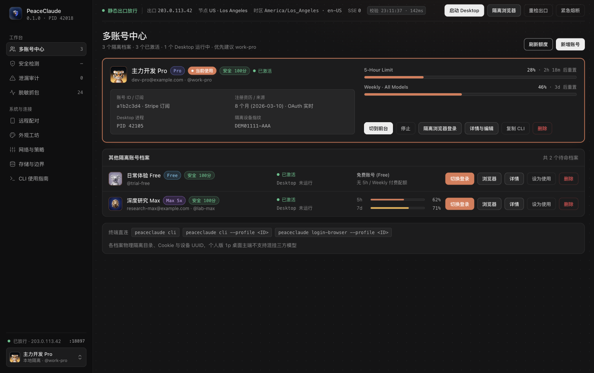
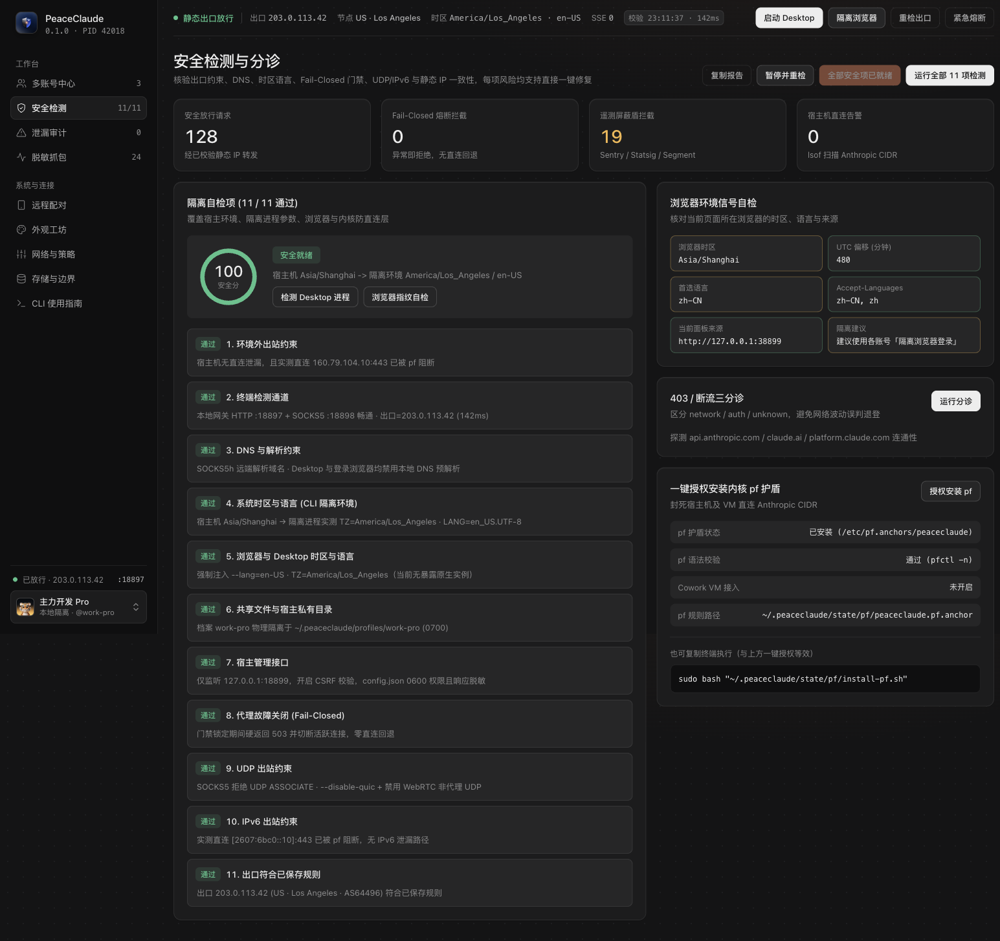
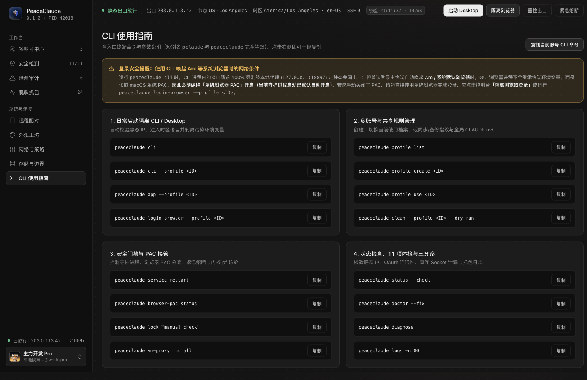
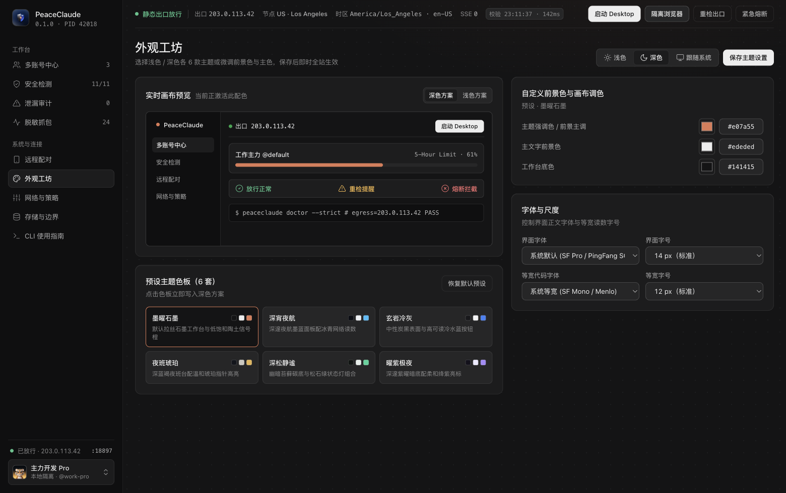
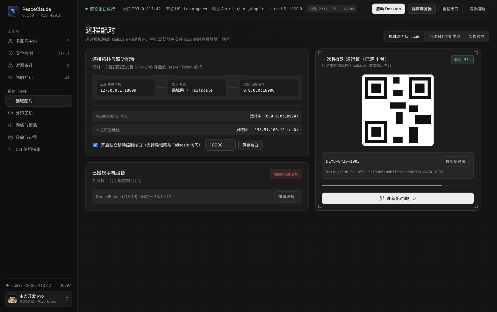

# PeaceClaude CLI & 控制台完整使用指南

> **仓库隐私与数据脱敏声明**：本仓库配置为 GitHub **Private（私有）** 仓库。下文与 `docs/screenshots/` 中涉及的域名、账户邮箱（`*@example.com`）、设备 UUID 及静态出口 IP（RFC 5737 保留文档地址 `203.0.113.42`）均来自独立隔离沙盒的演示数据，不包含任何个人真实静态节点或账户凭据。

`peaceclaude`（全命令行安装等效短别名 `pclaude`）面向 macOS 提供零虚拟机的 Claude Desktop、Claude Code CLI 与隔离浏览器多账号管理与 Fail-Closed 静态 IP 防风控安全套件。

---

## 一、快速上手与日常核心指令

```bash
# 1. 验证本地安全网关、静态出口 IP 与各端就绪状态
peaceclaude status

# 2. 执行 11 项全链路安全体检（发现配置问题可自动修复）
peaceclaude doctor
peaceclaude doctor --fix

# 3. 启动隔离版 Claude Code CLI（默认使用当前激活档案）
peaceclaude cli
pclaude cli --continue                 # 透传任意原生参数给 claude CLI
peaceclaude cli --profile work-pro     # 指定特定隔离档案运行 CLI

# 4. 启动隔离版 Claude Desktop 或打开可编辑 Web 控制台
peaceclaude app --profile work-pro
peaceclaude ui
```

---

## 二、安全前提必读：CLI 登录链路、PAC 与位置元数据

### 1. 用 `peaceclaude cli` 自动打开 Arc / Chrome / Safari 登录安全吗？
- **CLI 进程自身**：`peaceclaude cli` 会强制注入 `HTTP_PROXY` / `HTTPS_PROXY=127.0.0.1:18897`、`TZ` 与 `LANG=en_US.UTF-8`，并剥离宿主 `ANTHROPIC_BASE_URL` 等中转环境变量，因此 CLI 自身的全部 API 请求 **100% 经由静态 IP 代理出口**。
- **终端自动唤起系统浏览器（Arc 等）时**：终端环境变量**不会**继承给 macOS 已运行或新打开的 GUI 浏览器。系统浏览器访问 `claude.ai` 与 `platform.claude.com` 是否走静态出口，**完全取决于 macOS「系统浏览器 PAC」是否开启**：
  - **已开启 PeaceClaude PAC（守护进程默认自动开启）**：Arc / Chrome / Safari 访问 Claude 登录与授权域时自动走 `127.0.0.1:18897` 静态代理出口；同时不影响正常访问飞连内网、Google 等日常网站。
  - **手动关闭了 PAC 的情况**：若已手动关闭系统 PAC，切勿用默认普通浏览器完成登录（此时容易走当前宿主机网络导致 Split-IP）；请改用完全独立的隔离登录浏览器：
    ```bash
    peaceclaude login-browser --profile <ID>
    # 或直接在 Web 控制台点击账号卡上的「隔离浏览器登录」
    ```

### 2. Claude 账户 Privacy 中的 `Location metadata` 会暴露真实本地地址吗？
- Anthropic 的 `Location metadata`（结合服务侧风控判定）主要依据**出站请求的出口 IP 进行粗粒度城市/区域定位**，在静态代理出口下反映的是静态节点所在地信息，而不是本地城市。
- 为进一步杜绝网页端通过 HTML5 Geolocation API 探测宿主机 macOS CoreLocation，`peaceclaude login-browser` 在每次启动隔离 Chromium 前，都会在档案 `Default/Preferences` 中预写 `profile.default_content_setting_values.geolocation = 2`（全局禁止获取地理位置权限），同时禁用本地 `dns_prefetching`、`async_dns` 与 QUIC/UDP 直出。

---

## 三、全量 CLI 子命令速查

### 1. 日常入口启动

| 命令 | 别名 | 参数说明 | 作用与行为 |
|---|---|---|---|
| `peaceclaude cli` | `pclaude cli` | `--profile <ID>`、`--dry-run`、`-- <args...>` | 前置执行静态出口 Fail-Closed 门禁校验，注入静态代理与美区时区/语言后启动隔离版 Claude Code CLI |
| `peaceclaude app` | `pclaude app` | 子命令 `run \| takeover \| reset \| install`、`--profile <ID>`、`--dry-run` | 启动独立 `--user-data-dir` 与 `--disable-quic` 的 Claude Desktop；`takeover` 接管误开的原生实例 |
| `peaceclaude login-browser` | `browser` | `--profile <ID>`、`--dry-run`、`[url]` | 拉起带独立 `browser-profile`、强制代理、禁用 WebRTC UDP/Geolocation 与时区对齐的隔离登录浏览器 |
| `peaceclaude browser-pac` | `pac` | `status \| on \| enable \| off \| disable`、`--dry-run` | 管理 macOS 系统默认浏览器 PAC 分流（仅代理 Claude 域，Google/日常网页直连） |
| `peaceclaude ui` | `dashboard` | 无 | 在默认浏览器打开或聚焦本地 Web 工作台（默认 `http://127.0.0.1:18899`） |

### 2. 多账号档案（Profile）与规则同步

| 命令 | 别名 | 参数说明 | 作用与行为 |
|---|---|---|---|
| `peaceclaude profile list` | `profiles`, `org` | `--json` | 列出所有隔离档案、账号邮箱/UUID、套餐等级（含 Desktop Free 自动识别）、CLI/Desktop 激活状态 |
| `peaceclaude profile create <ID>` | `bind`, `add` | `--note '...'`、`--use` | 在 `~/.peaceclaude/profiles/<ID>/` 下新建物理隔离目录与独立设备指纹 |
| `peaceclaude profile use <ID>` | — | `<ID>` | 将指定档案设为「当前使用」（同步通知运行中的守护进程） |
| `peaceclaude profile delete <ID>` | `rm` | `<ID>` | 彻底删除指定非 `default` 档案数据并清理对应隔离进程；若删的是当前使用档案自动回切 `default` |
| `peaceclaude rules` | — | `status \| on \| sync \| off`、`--json` | 跨所有隔离档案同步共享全局 `CLAUDE.md`、`skills/`、`agents/`、`hooks/` |
| `peaceclaude clean` | `fingerprint-clean` | `--profile <ID>`、`--dry-run`、`--yes`、`--json` | 安全可恢复清理设备 UUID 与缓存痕迹（自动归档备份且严格保护 `CLAUDE.md`/`skills`/`settings.json`） |

### 3. 后台守护服务、静态 IP 上游与门禁防护

| 命令 | 别名 | 参数说明 | 作用与行为 |
|---|---|---|---|
| `peaceclaude service` | — | `start \| stop \| restart \| status \| run` | 管理 LaunchAgent 后台守护进程与本地 HTTP (`:18897`) / SOCKS5 (`:18898`) / 控制面 (`:18899`) |
| `peaceclaude config show` | — | 无 | 输出已自动脱敏的 `~/.peaceclaude/config.json` 当前配置 |
| `peaceclaude config set-upstream` | — | `--mode <local-proxy\|direct-socks5\|direct-http>`、`--addr HOST:PORT`、`--user`、`--pass`、`--expected-ip` | 切换直连 Webshare SOCKS5/HTTP（零 Split-IP）或接管本地 Clash |
| `peaceclaude config import-clash` | — | `--file PATH`、`--node NAME`、`--apply` | 安全预览 Clash 节点摘要并支持 `--apply` 一键导入为独立上游（绝不回显密码） |
| `peaceclaude config gateway` | — | 无 | 实时验证静态出口 IP、Split-IP 一致性与 `platform.claude.com` OAuth TLS 连通性 |
| `peaceclaude config set` | — | `<key> <value>` | 支持修改 `expected_ip`、`strict_split`、`telemetry_shield`、`auto_peace_desktop`、`cli_path`、`timezone`、`language` |
| `peaceclaude lock` / `unlock` | — | `[reason]` | 手动触发 Fail-Closed 紧急熔断（秒断全部 Anthropic 连接）/ 解锁并触发重检 |
| `peaceclaude vm-proxy` | `pf` | `status \| render \| on \| off \| install \| uninstall`、`--json` | 生成 `pfctl -n` 校验通过的 macOS `pf` 防直连 & IPv6 阻断规则与 Cowork VM 代理配置 |

### 4. 全链路体检、403 三分诊、审计与维护

| 命令 | 参数说明 | 作用与行为 |
|---|---|---|
| `peaceclaude status` | `--json`、`--check` | 汇总守护状态、出口 IP/城市/时区/语言、Split-IP 告警与 `pf` 状态 |
| `peaceclaude doctor` | `--json`、`--fix` | 运行 11 项隔离与网络体检（0-100 分），涵盖直连阻断、DNS、时区、Fail-Closed、UDP 与 IPv6 约束 |
| `peaceclaude diagnose` | `--json` | 遇到 HTTP 403 或连接异常时区分 `network` / `auth` / `unknown`，防止误操作退登伤及凭证 |
| `peaceclaude leaks` | `--since 24h`、`--clear`、`--json` | 结合网关拦截记录与宿主机 `lsof` 扫描定位直连 Anthropic CIDR 的泄露连接 |
| `peaceclaude capture` | `on \| off \| status \| list \| show <id> \| clear`（`--limit`、`--json`） | 本地脱敏请求抓包审计（`Authorization` / `Cookie` / Query Token 严格 `[REDACTED]`，30 天滚动清理） |
| `peaceclaude logs` | `-n 60` | 查看守护进程最近 N 行运行日志 |
| `peaceclaude setup` / `uninstall` | `--no-launchd`、`--no-app` / `--purge-data` | 初始化目录与启动器 / 卸载后台服务（默认保留隔离档案目录） |
| `peaceclaude version` | — | 打印构建版本号与 commit 摘要 |

---

## 四、Web 工作台核心页面说明（脱敏沙盒演示截图）

> 工作台默认由 `/Applications/PeaceClaude.app` 或 `http://127.0.0.1:18899` 打开，按极简高密度仪器风格设计；同样已将本指南内建进左侧 **「系统与连接 → CLI 使用指南」** 中支持一键复制。

### 1. 多账号中心（当前使用高亮 + 彩色套餐标签 + 安全得分 + 直接删除）
- **当前使用突出显示**：顶部焦点卡带主题主色高亮边框与 **「● 当前使用」** 胶囊标签，跟随主题切换自动联动变色。
- **Free 免费号清晰标识**：自动识别仅通过 Claude Desktop 激活的 `Free` 档案，在配额区明确说明「免费账号（Free）无 5h / Weekly 付费配额」，不显示令人误解的 `0%` 空白进度条；长账号名自动省略号截断且鼠标悬停可看全称。
- **安全得分直达与直接删除**：每张卡片均直接展示当前隔离安全得分（如 `安全 100分`），点击即跳「安全检测」；非 `default` 档案在列表即可二次点击直接删除。



### 2. 安全检测与分诊（右上角一键修复 + 即时刷新 + 11 项验证）
- 覆盖 IPv4/IPv6 出站拦截、SOCKS5 远端 DNS、美区时区语言、Desktop 防暴露、`Fail-Closed`、UDP 禁 QUIC 等 **11 项**；
- 检测项存在问题时，修复按钮统一对齐在**检查卡标题行右上角**；点击单项修复或顶部「一键修复全部」后自动触发复检并同步刷新条目状态、总分和所有账号安全徽章。



### 3. CLI 使用指南（工作台内置分页）
- 集中呈现 4 大分类常用命令，点击任意命令右侧 **「复制」** 或右上角 **「复制当前账号 CLI 命令」** 即刻写入剪贴板；顶部同步标注 CLI 唤起系统浏览器的 PAC 安全前置条件。



### 4. 外观工坊与远程配对台
- **7:5 外观工坊**：支持浅色/深色/跟随系统、5+5 原创配色板、实时微缩交互预览与配色导出。
- **7:5 远程配对台**：签发 120 秒有效一次性配对二维码，支持手机端扫码接入限权 `/mobile` 页面快速切换当前使用档案、查看额度与控制网关。

| 7:5 外观工坊 | 7:5 远程配对台 |
|---|---|
|  |  |
